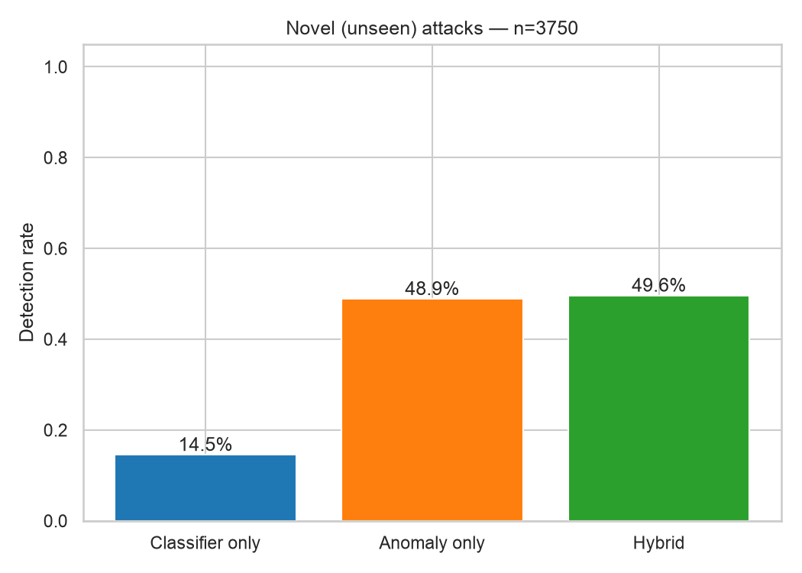

<div dir="rtl">

# 05 — التقييم والنتائج والمناقشة

> كل الأرقام هنا من تشغيل حقيقي لـ `netsentinel train` (seed = 42) ويمكن لأي عضو إعادة إنتاجها بالضبط.
> التقرير الكامل المولَّد آلياً: [`reports/RESULTS.md`](../reports/RESULTS.md).

## 1. منهجية التقييم

```
KDDTrain+ (125,973) ──► 80% تدريب ──► تدريب النماذج
                    └─► 20% تحقق  ──► اختيار أفضل نموذج + معايرة العتبة
KDDTest+  (22,544)  ──────────────► الاختبار النهائي (مرة واحدة فقط)
KDDTest-21 (11,850) ──────────────► الاختبار "الصعب"
```

**لماذا هذا مهم؟** أرقام التحقق تبدو مذهلة (Random Forest: كشف 99.85% وإنذار كاذب 0.06%). لكن هذا لأن التحقق من **نفس توزيع** التدريب. الاختبار الحقيقي هو KDDTest+ بهجماته الجديدة — وهناك تظهر الحقيقة.

## 2. مقارنة المصنِّفات (مجموعة التحقق — ملف full)

| النموذج | Macro-F1 | نسبة الكشف | الإنذار الكاذب | زمن التدريب |
|---|---|---|---|---|
| **Random Forest** ⭐ | **0.974** | 99.85% | **0.06%** | 10 ث |
| MLP | 0.959 | 99.74% | 0.15% | 5 ث |
| Hist Gradient Boosting | 0.902 | 99.91% | 0.24% | 11 ث |
| Logistic Regression | 0.710 | 99.78% | 5.18% | 23 ث |

**الملاحظة:** كل النماذج تكشف الهجمات بشكل عام (~99.8%)، لكن الفرق في **Macro-F1** (أي القدرة على تمييز الفئات النادرة R2L وU2R). Logistic Regression الخطّي ضعيف ← المشكلة غير خطية.

## 3. مقارنة كواشف الشذوذ (التحقق — عتبة النسبة المئوية 99)

| الكاشف | ROC-AUC | الكشف | الإنذار الكاذب |
|---|---|---|---|
| **Autoencoder** ⭐ | **0.991** | **88.7%** | 1.0% |
| Isolation Forest | 0.982 | 80.2% | 1.0% |

## 4. النتائج الرئيسية على KDDTest+ (بيانات لم يرها النظام)

### ملف full (40 ميزة) — Random Forest + Autoencoder

| الوضع | نسبة الكشف | الإنذار الكاذب | Precision | F1 | Accuracy |
|---|---|---|---|---|---|
| المصنِّف وحده | 57.58% | 2.61% | 96.69% | 0.722 | 74.73% |
| كاشف الشذوذ وحده | 68.10% | 1.62% | 98.24% | 0.804 | 81.14% |
| **الهجين** | **77.10%** | 3.12% | 97.03% | **0.859** | **85.62%** |

### ملف live (28 ميزة من الترويسات فقط) — MLP + Autoencoder

| الوضع | نسبة الكشف | الإنذار الكاذب | Precision | F1 | Accuracy |
|---|---|---|---|---|---|
| المصنِّف وحده | 66.70% | 2.98% | 96.73% | 0.790 | 79.76% |
| كاشف الشذوذ وحده | 65.77% | 3.22% | 96.42% | 0.782 | 79.13% |
| **الهجين** | **78.09%** | 3.71% | 96.53% | **0.863** | **85.93%** |

### نسبة الكشف لكل فئة (المصنِّف وحده ← الهجين)

| الفئة | full | live |
|---|---|---|
| DoS | 77.3% ← **87.1%** | 86.4% ← **95.7%** |
| Probe | 66.0% ← **88.9%** | 69.2% ← **96.4%** |
| R2L | 0.7% ← **41.6%** | 15.0% ← **18.4%** |
| U2R | 4.5% ← **64.2%** | 7.5% ← **22.4%** |

## 5. 🧬 النتيجة الأهم: الهجمات الجديدة (3,750 سجلاً من 17 نوعاً لم تُرَ في التدريب)

| الوضع | full | live |
|---|---|---|
| المصنِّف وحده | 14.5% | 34.5% |
| كاشف الشذوذ وحده | 48.9% | 69.3% |
| **الهجين** | **49.6%** | **71.6%** |



## 6. الحكم على الفرضيات

| | الفرضية | النتيجة | الدليل |
|---|---|---|---|
| **H1** | المصنِّف وحده يفشل في الهجمات الجديدة | ✅ **مؤكَّدة** | يكشف 14.5% فقط منها (full) رغم 99.85% على التحقق |
| **H2** | الهجين يرفع كشف الجديدة بشكل كبير | ✅ **مؤكَّدة** | 14.5% ← 49.6% (×3.4) في full، و34.5% ← 71.6% (×2.1) في live |
| **H3** | ثمن الإنذارات الكاذبة صغير | ✅ **مؤكَّدة** | +0.51 نقطة فقط (2.61% ← 3.12%) مقابل +19.5 نقطة كشف |
| **H4** | الترويسات وحدها تكفي تقريباً | ✅ **مؤكَّدة (مع مفاجأة)** | live حقّق كشفاً أعلى (78.1% مقابل 77.1%)، لكنه أضعف بوضوح في U2R |

## 7. المناقشة — ماذا تعني هذه الأرقام؟ (هذا الجزء يميّز البحث الجيد)

### 7.1 لماذا انخفضت الدقة من 99.9% (تحقق) إلى ~75% (اختبار)؟
ليس خطأً في الكود، بل هي **الحقيقة العلمية لـ NSL-KDD**: الاختبار مصمَّم بتوزيع مختلف وهجمات جديدة. البحث المرجعي لمنشئي البيانات (Tavallaee et al., 2009) سجّل دقة بين ~69% و~82% للمصنِّفات التقليدية على KDDTest+. نتيجتنا الهجينة **85.6%** تتجاوز ذلك. **أي بحث يدّعي 99% على NSL-KDD غالباً قسّم ملف التدريب فقط — احذروا هذا الفخ أمام اللجنة.**

### 7.2 لماذا الهجين أفضل؟ — "تكامل الأخطاء"
المصنِّف وكاشف الشذوذ **يخطئان في أماكن مختلفة**: المصنِّف يُخطئ في الجديد، والكاشف يُخطئ في الهجمات التي تشبه الطبيعي إحصائياً. اتحادهما يغطّي مساحة أوسع. لاحظ أن الكاشف وحده (68.1%) أفضل من المصنِّف وحده (57.6%) على الاختبار — عكس التحقق تماماً! وهذا دليل إضافي على أن التعلّم من "الطبيعي" أكثر متانة أمام التغيّر.

### 7.3 لماذا R2L صعبة؟ (تحليل لكل نوع هجوم — ملف full)

| الهجوم | العدد | جديد؟ | المصنِّف وحده | الهجين |
|---|---|---|---|---|
| guess_passwd | 1,231 | لا | 0% | **38%** |
| warezmaster | 944 | لا | 1% | **73%** |
| snmpguess | 331 | نعم | 0% | 0% |
| snmpgetattack | 178 | نعم | 0% | 0% |
| httptunnel | 133 | نعم | 4% | 8% |

ثلاث ملاحظات مهمة:
1. **حتى الهجمات "المعروفة" فشل فيها المصنِّف:** `guess_passwd` موجود في التدريب (53 سجلاً فقط)، لكن نسخ الاختبار (1,231) نُفّذت بطريقة مختلفة فلم تطابق ما حفظه المصنِّف ← 0%. كاشف الشذوذ أنقذ 38% منها. **التعلّم من الطبيعي أكثر متانة من حفظ أمثلة الهجوم.**
2. **هجمات SNMP مستحيلة بهذه الميزات:** طلبات `snmpguess`/`snmpgetattack` **متطابقة في الميزات تقريباً مع طلبات SNMP طبيعية** (اتصال UDP قصير بنفس الحجم). لا يمكن لأي نموذج التفريق بين سجلّين متطابقين — المشكلة في **البيانات** لا في الخوارزمية. الحل يحتاج ميزات من محتوى SNMP نفسه (مثل community string).
3. هذه الأنواع الخمسة تمثّل 97% من R2L في الاختبار، لذلك نسبة R2L الإجمالية منخفضة.

### 7.4 مفاجأة: live (28 ميزة) ≥ full (40 ميزة) في الكشف العام
تفسيرنا: ميزات المحتوى (`hot`, `num_failed_logins`...) تجعل المصنِّف **يحفظ** أنماط R2L/U2R الخاصة بالتدريب، فيفشل عند تغيّرها (Overfitting على الميزات). بإزالتها يُجبَر النموذج على تعلّم أنماط **سلوكية** أعمّ. لكن full يبقى أفضل بوضوح في **U2R** (64% مقابل 22%) لأن رفع الصلاحيات يُرى في المحتوى (`root_shell`) لا في الترويسات.

### 7.5 KDDTest-21: الإنذارات الكاذبة أعلى (14%)
هذا الملف يحوي **فقط السجلات التي أخطأت فيها أغلب المصنِّفات المرجعية**، بما فيها سجلات طبيعية "غريبة". لذلك ارتفاع الإنذار الكاذب متوقَّع، ويبقى الهجين الأفضل في الكشف (69.7% مقابل 43.9%).

### 7.6 أهمّ الميزات
`src_bytes` (حجم البيانات المرسلة) هي الأهم في الملفين، تليها `service` و`protocol_type` و`flag`. هذا منطقي أمنياً: SYN flood يرسل 0 بايت، تسريب البيانات يرسل كثيراً، وكل هجوم يستهدف خدمة معيّنة.

## 8. نتائج العرض الحي (ملف pcap صناعي)

| الملف | الاتصالات | النتيجة |
|---|---|---|
| `demo_normal.pcap` (5 دقائق تصفّح + DNS) | 1,190 | **0 إنذار كاذب** ✅ |
| `demo_attack.pcap` — SYN Flood | 2,942 | 99.0% كُشفت (98.8% DoS + 0.2% شذوذ) ✅ |
| `demo_attack.pcap` — Ping Sweep | 254 | **100%** (Probe) ✅ |
| `demo_attack.pcap` — Port Scan | 599 | **100%** كُشفت، لكن ثلثاها سُمّي DoS بدل Probe ⚠️ |

- **مسح المنافذ ← DoS:** المسح السريع (600 منفذ في ثانية) يولّد مئات الاتصالات المرفوضة خلال ثانيتين لنفس الهدف — إحصائياً يشبه `neptune` (وهو DoS في NSL-KDD ويظهر أيضاً بحالة REJ). **الكشف صحيح، التسمية تقريبية.**
- **ضحايا جانبيون:** اتصالات المستخدمين الطبيعيين **أثناء** الـ SYN flood تحمل ميزات نافذة "ملوّثة" (`serror_rate` للخادم ≈ 1.0) فيُشتبَه بها. هذا قيد معروف لميزات النوافذ (تصف حالة **الهدف** لا نية **المصدر**). تجميع الحوادث حسب المصدر يُظهر للمحلّل أن المهاجم الحقيقي مصدر واحد بـ 3,308 اتصالاً.

## 9. القيود والعمل المستقبلي

| القيد | العمل المستقبلي المقترح |
|---|---|
| بيانات 1998 | ✅ **أُنجز**: التقييم على CIC-IDS2017 الحقيقية — انظر [10](10_real_traffic_cicids2017.md) |
| R2L ضعيفة | ميزات محتوى من بروتوكولات التطبيقات (SNMP, HTTP) |
| ميزات النوافذ تُشرك الضحايا | ميزات نوافذ مبنية على **المصدر** أيضاً |
| العتبة ثابتة | عتبة تكيّفية حسب الوقت/نوع الخدمة |
| التصنيف لا يتعلّم من الجديد | Active Learning: المحلّل يُسمّي "Unknown-Anomaly" فيُعاد التدريب |
| احتمالية التهرّب (Adversarial) | اختبار المتانة ضد مهاجم يعرف النموذج |

</div>
