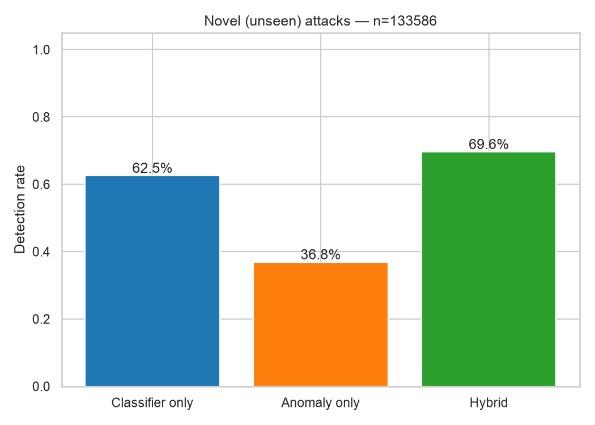
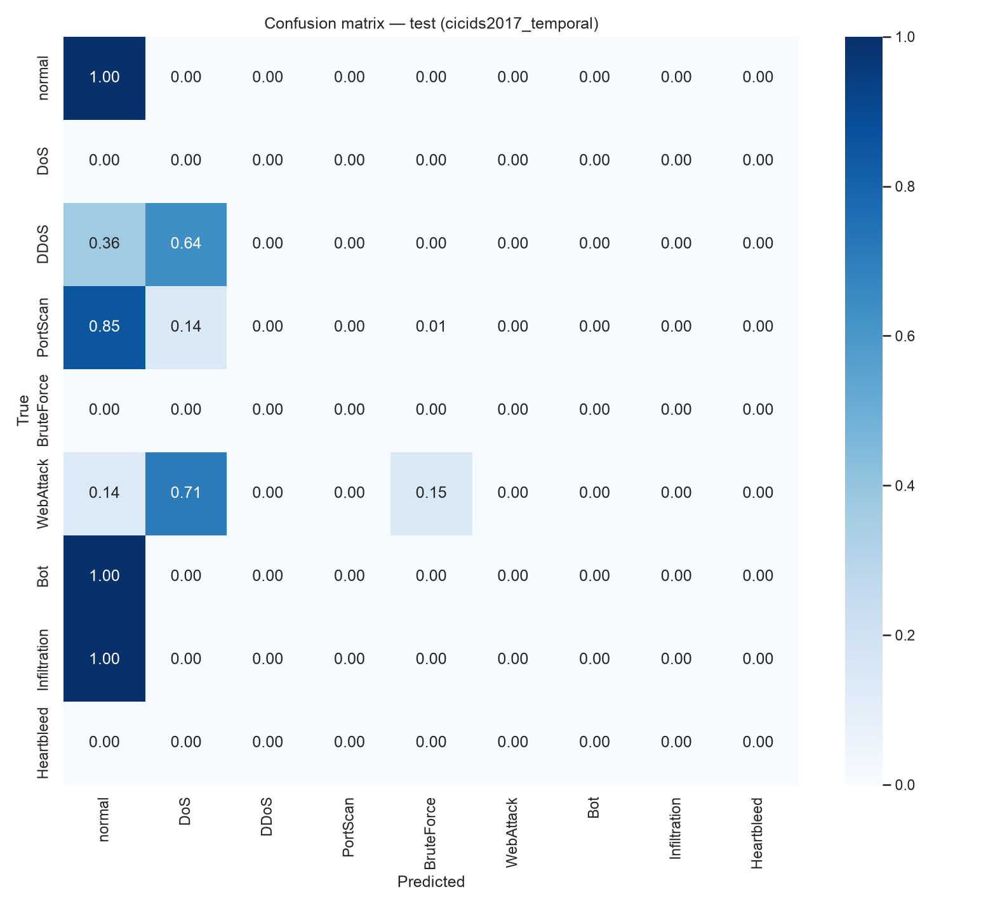
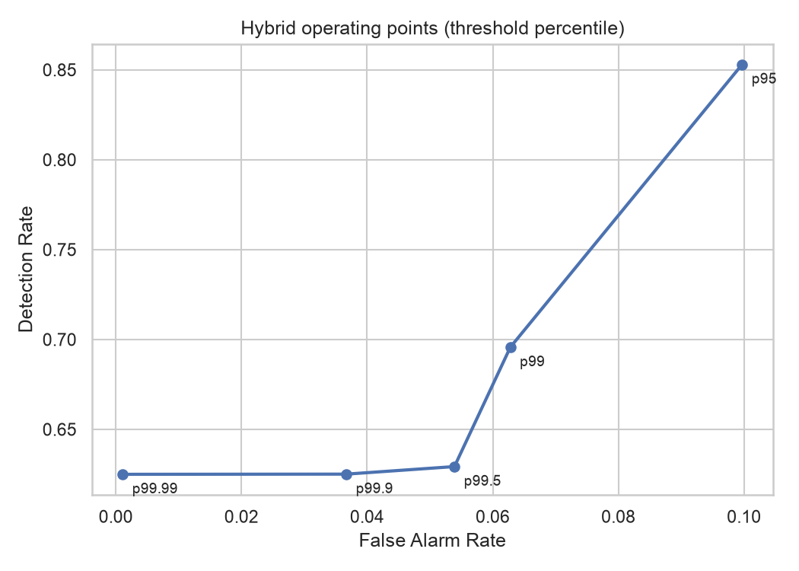

<div dir="rtl">

# 10 — التجربة على حركة حقيقية حديثة: CIC-IDS2017

> هذا الفصل يجيب عن أقوى سؤال ستطرحه اللجنة: **"NSL-KDD من 1998 — هل يعمل نظامكم على شبكات اليوم؟"**
> كل الأرقام من تشغيل حقيقي لـ `netsentinel train --dataset cicids2017` (seed = 42). التقرير الآلي: [`reports/RESULTS_CICIDS2017.md`](../reports/RESULTS_CICIDS2017.md).

## 1. ما هي CIC-IDS2017؟

| | |
|---|---|
| **المصدر** | المعهد الكندي للأمن السيبراني — جامعة نيو برونزويك ([الصفحة الرسمية](https://www.unb.ca/cic/datasets/ids-2017.html)) |
| **البحث** | Sharafaldin, Lashkari & Ghorbani (2018), *Toward Generating a New Intrusion Detection Dataset*, ICISSP |
| **ما هي** | شبكة حقيقية: 25 مستخدماً (Windows 7/8/10, Ubuntu, macOS) + خوادم، سُجّلت **5 أيام عمل** (3–7 تموز 2017) |
| **الهجمات** | **حقيقية بأدوات حقيقية**: LOIC, Hulk, GoldenEye, Slowloris, Patator, nmap, Metasploit, Ares botnet, Heartleech |
| **الحجم** | 2,830,743 تدفّقاً (Flow) — 78 ميزة لكل تدفّق من أداة CICFlowMeter |
| **ملفنا** | `MachineLearningCSV.zip` الأصلي (235 MB)، تحقّقنا من سلامته بـ SHA-256 = `c3f26274…727928` |

### الهجمات حسب الأيام — وهذا مفتاح التجربة

| اليوم | ما حدث | الفئة عندنا |
|---|---|---|
| الاثنين | حركة طبيعية فقط | — |
| الثلاثاء | تخمين كلمات مرور FTP و SSH (Patator) | BruteForce |
| الأربعاء | DoS Hulk, GoldenEye, Slowloris, Slowhttptest + Heartbleed | DoS, Heartbleed |
| الخميس | هجمات ويب (Brute Force, XSS, SQL Injection) + اختراق داخلي (Infiltration) | WebAttack, Infiltration |
| الجمعة | Botnet (Ares) + مسح منافذ (nmap) + DDoS (LOIC) | Bot, PortScan, DDoS |

### الفرق عن NSL-KDD

| | NSL-KDD | CIC-IDS2017 |
|---|---|---|
| السنة | 1998 | **2017** |
| الوحدة | اتصال (connection) | تدفّق (flow) ثنائي الاتجاه |
| الميزات | 41 (بعضها من المحتوى) | 78 إحصائية من **الترويسات والتوقيت فقط** |
| الهجمات | قديمة | حديثة: هجمات ويب، botnet، Heartbleed، DDoS |
| الحركة الطبيعية | محاكاة | **مستخدمون حقيقيون** (HTTP/HTTPS, SSH, FTP, email) |

## 2. تنظيف البيانات (`data/cicids.py → load_cicids`)

البيانات الحقيقية "قذرة" — وتنظيفها جزء أساسي من البحث:

| المشكلة | الحل | العدد |
|---|---|---|
| قيم `Infinity` و `NaN` (قسمة على صفر داخل CICFlowMeter عندما مدة التدفّق = 0) | حذف السطر | 2,867 |
| **سطور مكرّرة حرفياً** | حذف (وإلا قد يظهر نفس السجل في التدريب والاختبار فتنتفخ النتائج) | 594,712 |
| حرف مكسور في الأسماء: `Web Attack � XSS` | إصلاح إلى `Web Attack - XSS` | — |
| عمود `Fwd Header Length.1` مكرّر | حذف | 1 |
| 8 أعمدة صفرية في كل السجلات (Bulk features...) | حذف | 8 |
| **`Destination Port`** | **حذف عمداً** (انظر أدناه) | 1 |

**النتيجة: 2,233,164 تدفّقاً فريداً و 68 ميزة.**

### لماذا حذفنا رقم المنفذ؟ ("الطريق المختصر" — Shortcut Learning)
لو أبقيناه، قد يتعلّم النموذج قاعدة سخيفة مثل "المنفذ 21 يوم الثلاثاء = هجوم" بدل أن يتعلّم **شكل** الهجوم. في الواقع، المهاجم يغيّر المنفذ بسهولة. حذفه يجبر النموذج على تعلّم **السلوك** (التوقيت، الأحجام، الأعلام).

**أثر جانبي مهم:** بعد حذف المنفذ، تدفّقات مسح المنافذ (158,930) أصبحت متطابقة تقريباً — كل حزمة SYN لمنفذ مختلف تبدو نفس الشيء — فانكمشت إلى **1,956 تدفّقاً فريداً**. هذا صحيح علمياً: 157 ألف نسخة من نفس الشكل لا تضيف معلومة، بل كانت ستضخّم الأرقام.

### توزيع البيانات بعد التنظيف

| الفئة | العدد |
|---|---|
| normal | 1,896,672 |
| DoS | 193,745 |
| DDoS | 128,014 |
| BruteForce | 9,150 |
| WebAttack | 2,143 |
| PortScan | 1,956 |
| Bot | 1,437 |
| Infiltration | 36 |
| Heartbleed | 11 |

## 3. التجربتان — والمقارنة بينهما هي الرسالة

### ① التقسيم العشوائي — "ما تفعله أغلب الأبحاث"
نخلط الأيام الخمسة، ونأخذ 30% عشوائياً للاختبار (669,950 تدفّقاً).
← **كل نوع هجوم في الاختبار رآه النموذج في التدريب.**

### ② التقسيم الزمني — "ما يحدث في الواقع"
ندرّب على **الاثنين–الأربعاء** فقط، ونختبر على **الخميس–الجمعة كاملين** (811,780 تدفّقاً).
← **كل هجمات الاختبار من أنواع لم يرها النظام قط** (133,586 تدفّقاً هجومياً من 7 أنواع). هذه محاكاة صادقة ليوم يواجه فيه نظام حقيقي هجمات جديدة.

**عيّنة التدريب (في التجربتين):** 250 ألف طبيعي + حتى 50 ألفاً من كل نوع هجوم (النادر يُؤخذ كاملاً). أما **الاختبار فعلى الكل** دون اختزال.

## 4. النتائج

### ① التقسيم العشوائي (Random Forest + Autoencoder)

| الوضع | الكشف | الإنذار الكاذب | Precision | F1 |
|---|---|---|---|---|
| **المصنِّف وحده** | **99.66%** | **0.12%** | 99.32% | **0.995** |
| كاشف الشذوذ وحده | 65.51% | 0.93% | 92.62% | 0.767 |
| الهجين | 99.68% | 1.03% | 94.49% | 0.970 |

**القراءة:** أرقام شبه مثالية — وهذا ما تنشره أغلب الأبحاث. والهجين **لا يضيف شيئاً تقريباً** (+0.02 نقطة) بل يرفع الإنذار الكاذب. منطقي: عندما يعرف المصنِّف كل الهجمات، لا حاجة لشبكة أمان.

### ② التقسيم الزمني — Zero-day حقيقي (Gradient Boosting + Autoencoder)

| الوضع | الكشف | الإنذار الكاذب | Precision | F1 |
|---|---|---|---|---|
| المصنِّف وحده | 62.50% | 0.10% | 99.20% | 0.767 |
| كاشف الشذوذ وحده | 36.83% | 6.18% | 53.99% | 0.438 |
| **الهجين** | **69.57%** | 6.28% | 68.57% | 0.691 |

**الكشف لكل نوع هجوم جديد:**

| الهجوم (لم يُرَ في التدريب) | المصنِّف وحده | الهجين | التفسير |
|---|---|---|---|
| **PortScan** | 14.7% | **87.0%** | لا يشبه أي هجوم في التدريب ← المصنِّف أعمى، والكاشف يراه غريباً |
| **Infiltration** | 0% | **55.6%** | اختراق داخلي — لا مثيل له في التدريب |
| DDoS | 63.6% | **69.8%** | يشبه DoS الأربعاء جزئياً ← المصنِّف يعرف بعضه |
| WebAttack | 86.3% | 86.3% | يشبه Brute Force/DoS على HTTP ← المصنِّف يلتقطه |
| Bot | 0% | 0% | ❌ حركة الـ botnet تشبه الطبيعي تماماً إحصائياً |



**مصفوفة الالتباس تكشف كيف "يفكّر" المصنِّف أمام المجهول:** لم يرَ هجمات ويب قط، فسمّى 71% منها **DoS** و15% **BruteForce** — أي ربطها بأقرب ما يعرفه (هجمات على HTTP، وتخمين متكرّر). الكشف صحيح والتسمية تقريبية. أما مسح المنافذ فـ 85% منه اعتبره **طبيعياً** تماماً، وهنا يأتي دور كاشف الشذوذ.



## 5. ماذا تعلّمنا؟ (المناقشة)

### 5.1 الرسالة الأهم: "99%" في الأبحاث وهمٌ مريح
نفس النموذج، نفس البيانات، نفس الكود:
- تقسيم عشوائي ← **99.7%** كشف.
- تقسيم زمني ← **62.5%** كشف.

الفرق ليس في الخوارزمية، بل في **طريقة التقييم**. التقسيم العشوائي يسأل "هل تتذكّر ما رأيت؟" والزمني يسأل "هل تكتشف ما لم ترَ؟" — والثاني هو السؤال الأمني الحقيقي. هذا يتّفق مع أبحاث منشورة تنتقد تقييم IDS (مثل Sommer & Paxson 2010؛ Engelen et al. 2021 عن مشاكل CIC-IDS2017).

### 5.2 الهجين يفيد بالضبط حيث يجب
في العالم المغلق (عشوائي) لا يفيد. في العالم المفتوح (زمني) يرفع الكشف **+7.1 نقطة** إجمالاً، و**+72 نقطة لمسح المنافذ** و**+56 نقطة للاختراق الداخلي**. هذا يؤكّد الفرضية H2 على **بيانات حقيقية حديثة**.

### 5.3 الثمن الحقيقي: "انجراف الطبيعي" (Concept Drift)
على NSL-KDD كان ثمن الهجين +0.5 نقطة إنذار كاذب. هنا **+6.2 نقطة**. لماذا؟
- العتبة عُوّرت على طبيعي **الاثنين–الأربعاء** لتعطي 1% إنذاراً كاذباً.
- لكن الحركة الطبيعية **يوم الخميس والجمعة مختلفة** (مستخدمون يفعلون أشياء أخرى، خدمات أخرى).
- فارتفع الإنذار الكاذب الفعلي إلى 6.2%.

هذه ليست ثغرة في الكود — إنها **أهم مشكلة مفتوحة في كشف الشذوذ** في الأبحاث، وقد ظهرت عندنا بالأرقام. الحلول: (1) رفع العتبة (انظر جدول الحساسية أدناه)، (2) إعادة معايرة دورية على حركة حديثة (أمر `baseline`)، (3) مراجعة المحلّل لتنبيهات "Unknown-Anomaly" قبل التصعيد.

### 5.4 Bot: حدود التعلّم الإحصائي
Botnet "Ares" يتواصل مع خادم التحكّم عبر HTTP عادي بفترات منتظمة — في ميزات التدفّق الواحد يبدو **كتصفّح طبيعي**. كشفه يحتاج تحليلاً عبر الزمن لنفس الجهاز (Beaconing detection) — عمل مستقبلي ممتاز.

### 5.5 Isolation Forest ضعيف جداً هنا
على التحقق: كشف 2.5% فقط عند إنذار 1% (مقابل 60% للـ Autoencoder). مع 68 ميزة مترابطة بقوة، التقسيمات العشوائية لغابة العزل تضيع في أبعاد غير مفيدة، بينما الـ Autoencoder يتعلّم **العلاقات** بين الميزات. **لهذا نقارن ولا نفترض.**

## 6. حساسية العتبة

كل العتبات محسوبة من **طبيعي التحقق (الاثنين–الأربعاء)** وقت التدريب — لم نختر شيئاً بناءً على الاختبار. الجدول يعرض "منحنى التشغيل" للتجربة الزمنية:

| النسبة المئوية للعتبة | الكشف | الإنذار الكاذب | Precision | F1 |
|---|---|---|---|---|
| 95 | **85.3%** | 9.97% | 62.8% | 0.723 |
| 99 (الافتراضي) | 69.6% | 6.28% | 68.6% | 0.691 |
| 99.5 | 62.9% | 5.39% | 69.7% | 0.662 |
| 99.9 | 62.5% | 3.67% | 77.0% | 0.690 |
| 99.99 | 62.5% | **0.11%** | **99.2%** | **0.767** |
| *(المصنِّف وحده للمقارنة)* | 62.5% | 0.10% | 99.2% | 0.767 |



**القراءة — قرار إداري لا تقني:**
- **مؤسسة حسّاسة** (بنك، جهة حكومية): عتبة 95 ← تكشف **85%** من الهجمات الجديدة، مقابل إنذار كاذب لكل 10 تدفّقات طبيعية. يحتاج فريق SOC كبيراً.
- **مؤسسة بفريق صغير**: عتبة 99.99 ← إنذارات نظيفة جداً (0.1%) لكن كاشف الشذوذ يصبح صامتاً تقريباً ولا يضيف على المصنِّف.
- **ملاحظة مهمة:** المكسب الحقيقي للهجين على الحركة الحديثة يحتاج عتبة منخفضة، وهذا يكشف ثمن "انجراف الطبيعي" (5.3) بوضوح. على NSL-KDD المقايضة أفضل بكثير (عتبة 95: كشف 85.7% وإنذار كاذب 5.8%).

## 7. مقارنة نهائية: NSL-KDD مقابل CIC-IDS2017

| | NSL-KDD (KDDTest+) | CIC-IDS2017 (زمني) |
|---|---|---|
| كشف المصنِّف وحده | 57.6% | 62.5% |
| كشف الهجين | **77.1%** | **69.6%** |
| ارتفاع الإنذار الكاذب | +0.5 نقطة | +6.2 نقطة |
| أكبر مكسب | U2R: 4% ← 64% | PortScan: 15% ← 87% |
| أكبر فشل | SNMP (R2L) | Bot |

**الخلاصة البحثية:** الفرضية الأساسية (الهجين يكشف ما يفوت المصنِّف) **صحّت على مجموعتي بيانات مستقلّتين بفارق 19 عاماً**، مع ثمن في الإنذارات الكاذبة يجب إدارته بالعتبة وإعادة المعايرة.

## 8. التشغيل

<div dir="ltr">

```bash
netsentinel download --dataset cicids2017          # 235 MB + SHA-256 check
netsentinel train --dataset cicids2017             # both experiments, ~20 min
netsentinel train --dataset cicids2017 --experiment temporal
```

</div>

## 9. حزم حقيقية من جهازنا: nmap + HTTP flood (التقاط فعلي)

بعد CIC-IDS2017، اختبرنا السلسلة الكاملة **من الحزمة الخام إلى التنبيه** على حركة حقيقية التقطناها بأنفسنا (3 تشرين الثاني 2026) بالسكربت `tools/capture_real_traffic.sh`:

| الملف | ما فيه | الحجم |
|---|---|---|
| `data/real/real_normal.pcap` | 60 ثانية تصفّح طبيعي لخادم ويب محلي | 235 اتصالاً |
| `data/real/real_attack.pcap` | تصفّح طبيعي + **nmap SYN scan** (المنافذ 1–2000) + **nmap -sV** + **HTTP flood** (3000 طلب، 100 متوازية) | 5,537 اتصالاً |

كل الهجمات موجّهة إلى `127.0.0.1` (الجهاز نفسه) — لم تخرج حزمة واحدة إلى أي شبكة.

### النتائج

| الحركة الحقيقية | النموذج الأساسي (NSL-KDD live) | بعد `baseline` على طبيعي الجهاز |
|---|---|---|
| تصفّح طبيعي نظيف (قبل بدء الهجمات) | **0 إنذار كاذب** من 25 | **0 إنذار كاذب** من 25 |
| nmap port scan (2,110 اتصالات) | **100%** (2,104 Probe + 6 شذوذ) | **100%** |
| HTTP flood (3,000 طلب) | **0%** ❌ | **89.3%** (2,679 Unknown-Anomaly) ✅ |

### لماذا فات النموذجَ الأساسي الـ HTTP flood؟
كل طلب في الـ flood **اتصال TCP كامل وصحيح** (مصافحة + GET + رد + إغلاق، flag = SF). في بيانات 1998، خادم ويب مشغول بمئات الاتصالات المكتملة في الثانية يبدو **طبيعياً**. هجمات DoS في NSL-KDD كانت على مستوى الشبكة (SYN flood, smurf) لا على مستوى التطبيق.

### لماذا نجح بعد `baseline`؟
أمر `netsentinel baseline data/real/real_normal.pcap` علّم كاشف الشذوذ أن "الطبيعي **على هذا الجهاز**" هو ~3 اتصالات في الثانية. فعندما وصلت 468 اتصالاً في ثانيتين، أصبح ذلك شاذّاً جداً. **هذا بالضبط ما صُمّم الهجين لأجله**: المصنِّف لا يعرف هذا الهجوم، وكاشف الشذوذ المضبوط محلياً التقطه.

### ⚠️ ملاحظة صادقة: الضحايا الجانبيون
اتصالات التصفّح الطبيعي **أثناء** الهجمات أُنذر عن بعضها (~21%). السبب: في التجربة المحلية كل الحركة من `127.0.0.1` إلى `127.0.0.1`، فميزات النوافذ ("آخر الاتصالات لنفس الهدف") تخلط الهجوم بالطبيعي. على شبكة حقيقية بعناوين مختلفة يقلّ هذا كثيراً، لكنه قيد معروف لميزات النوافذ (انظر 05).

### 🐛 خطآن حقيقيان اكتشفناهما فقط بفضل الحزم الحقيقية

| الخطأ | العَرَض | السبب | الإصلاح |
|---|---|---|---|
| **حجم الحمولة خاطئ** | كل اتصالات الـ flood بدت 72 بايت | tcpdump يلتقط أول 128 بايت فقط (snaplen)، والكود كان يقيس البايتات **الملتقَطة** | نقرأ الطول الحقيقي من حقل *Total Length* في ترويسة IP (`_ip_payload_length` في `live/capture.py`) |
| **إنذارات كاذبة في أول 4 ثوانٍ** | 9 من 25 اتصالاً طبيعياً أُنذر عنها بعد `baseline` | تقسيم بيانات المعايرة **بالترتيب الزمني**: اتصالات "بداية الالتقاط" (نوافذ فارغة) وقعت كلها في التدريب، فلم ترَها العتبة | خلط عشوائي قبل التقسيم في `refit_baseline` ← 0 إنذار كاذب |

وأُضيف لكل خطأ **اختبار آلي** يمنع عودته (37 اختباراً الآن). الحزم الصناعية في `demo_attack.pcap` كانت كاملة ومثالية، فلم تكشف أياً من الخطأين — **وهذا درس هندسي مهم: البيانات الحقيقية تكشف ما لا تكشفه المحاكاة.**

### إعادة التجربة

<div dir="ltr">

```bash
sudo bash tools/capture_real_traffic.sh                 # ~2.5 min, needs root for packet capture
netsentinel pcap data/real/real_attack.pcap             # base model
netsentinel baseline data/real/real_normal.pcap         # learn this machine's normal
netsentinel pcap data/real/real_attack.pcap --model artifacts/live/hybrid_ids_custom.joblib
```

</div>

وفي الموقع: قسم **Analyze** ← اضغط `real_attack.pcap`. أو قسم **Tape** الذي يعيد تشغيلها تلقائياً.

</div>
