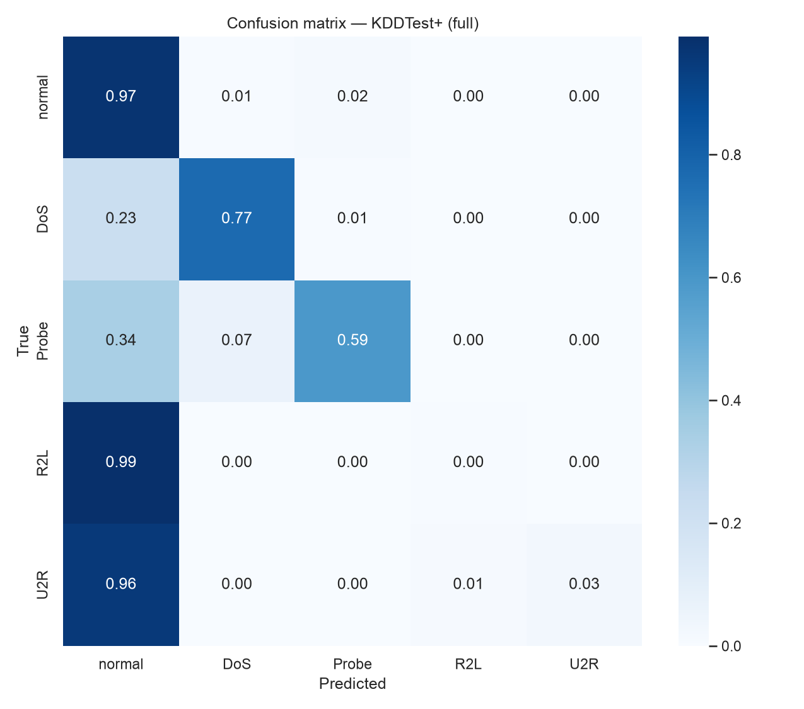
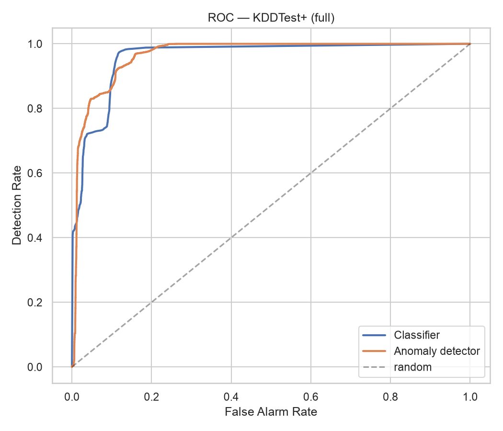
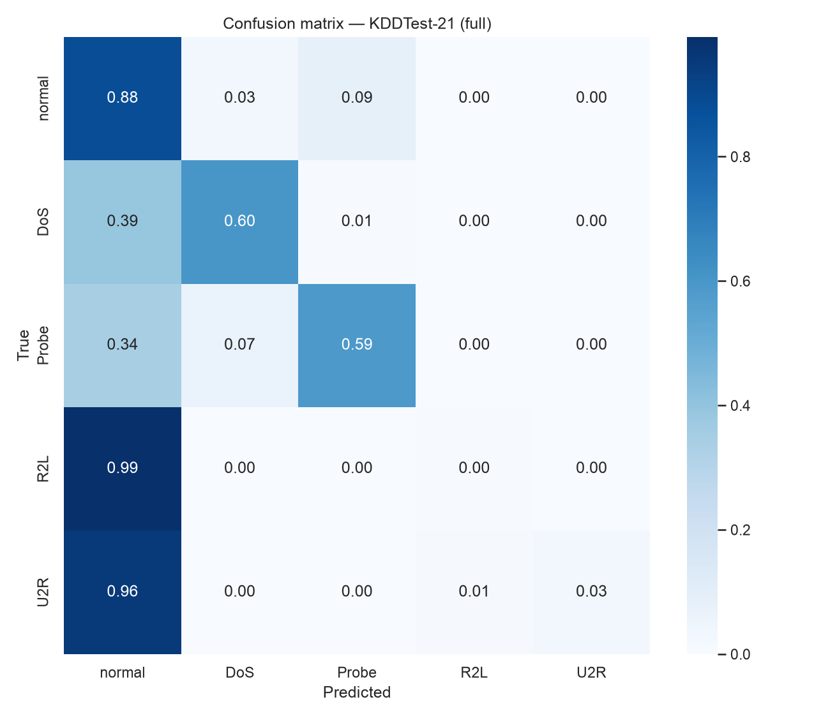
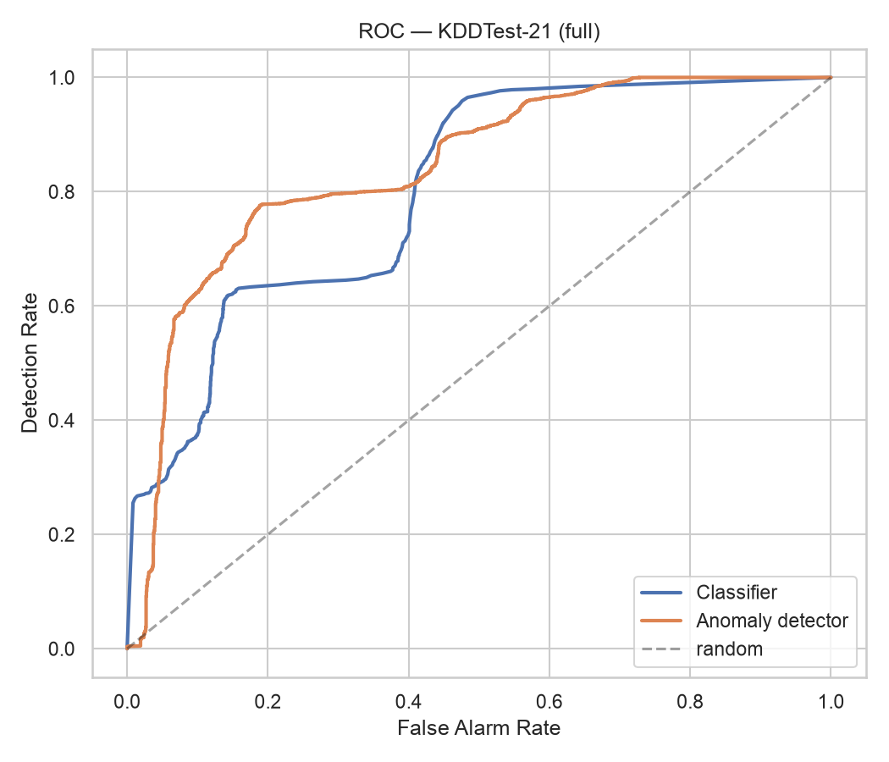
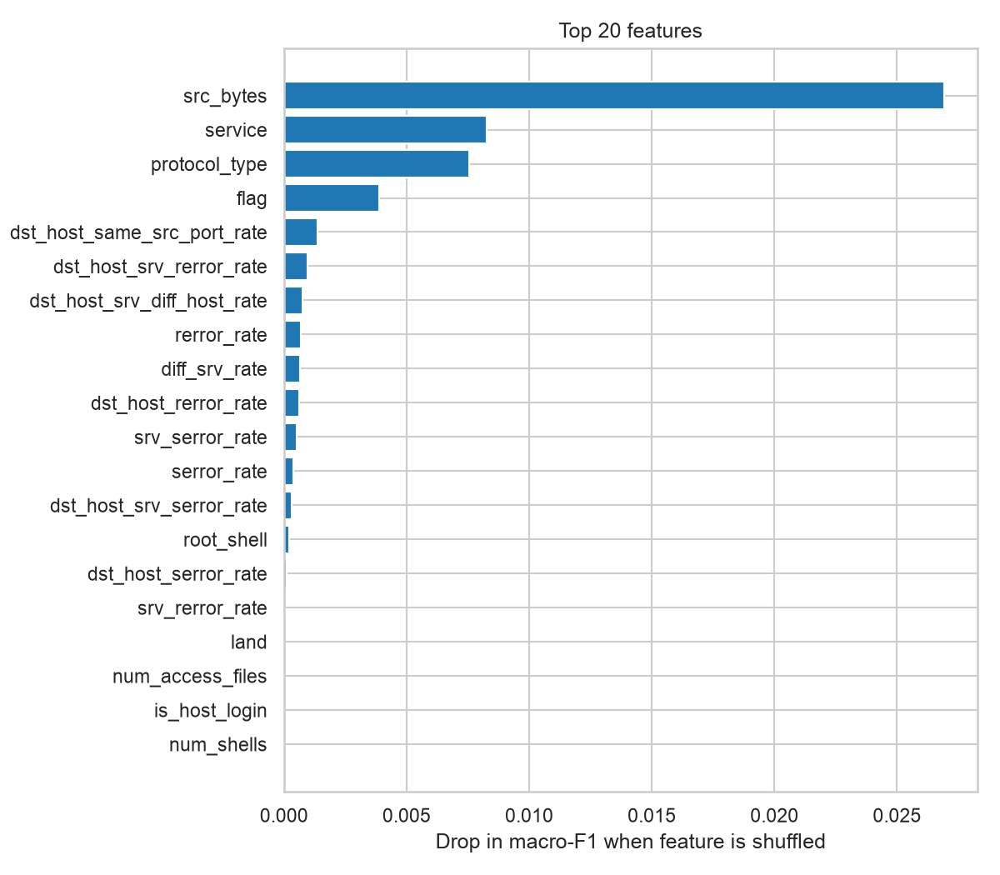
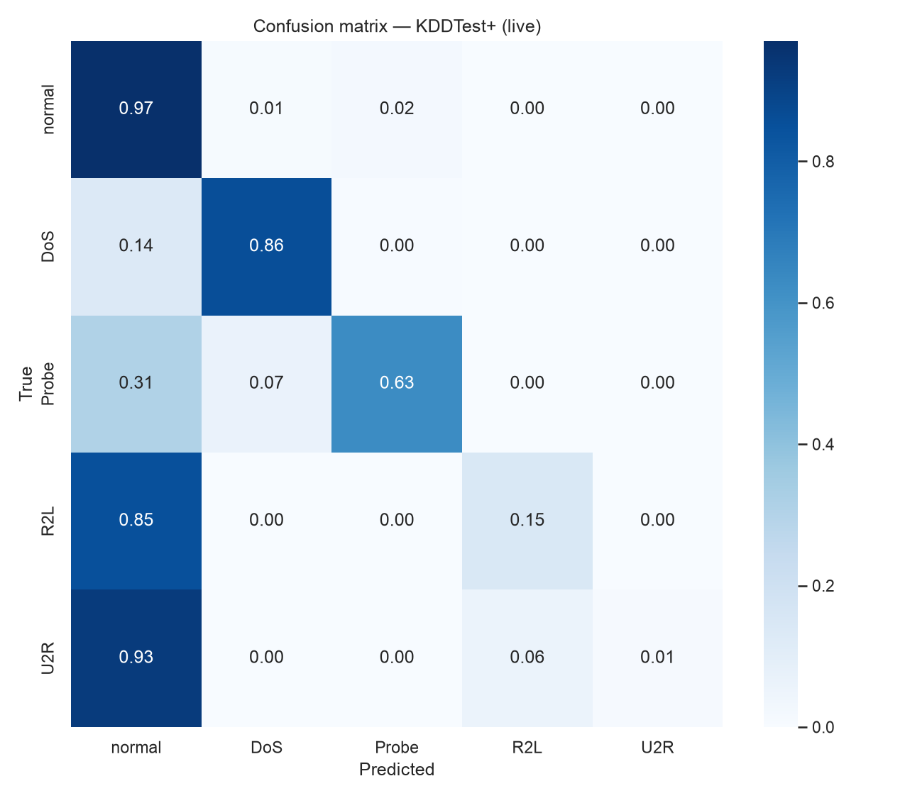
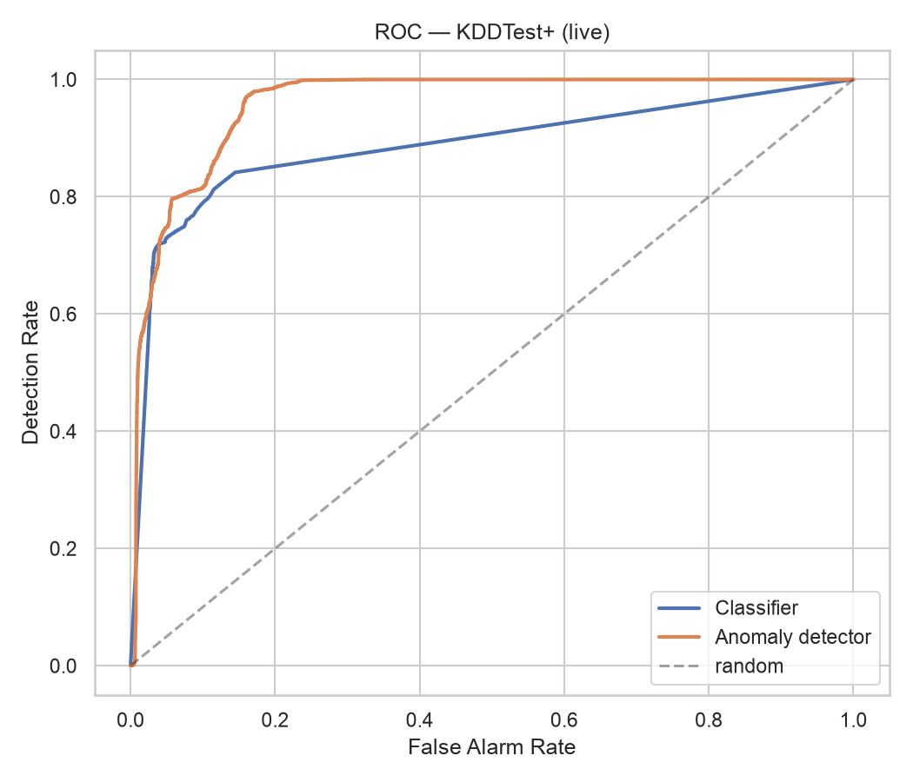
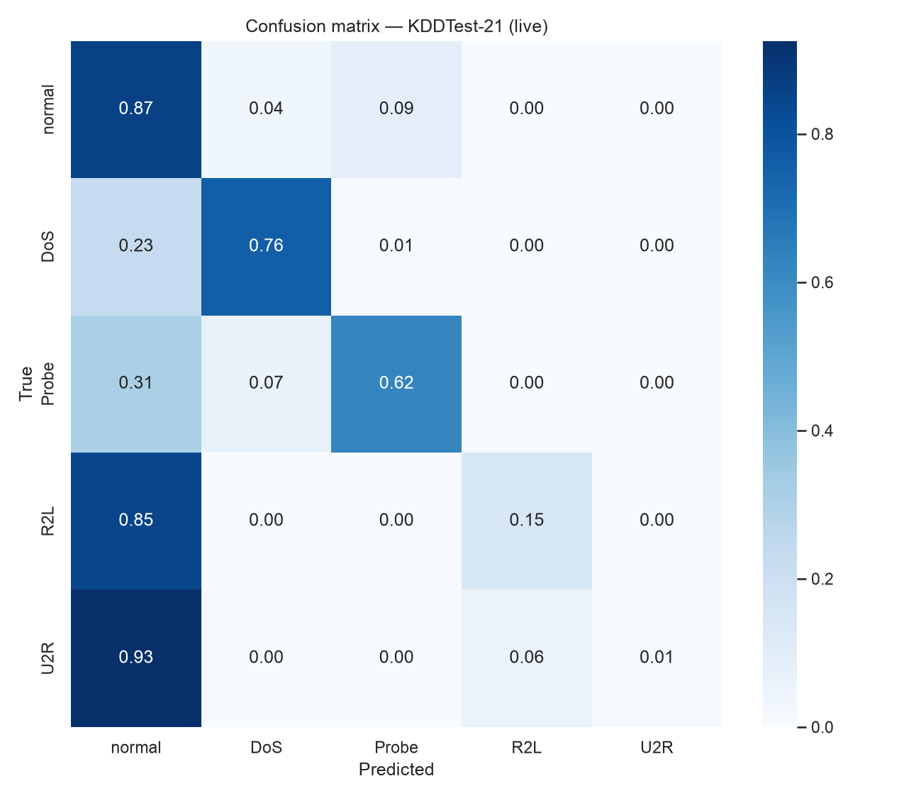
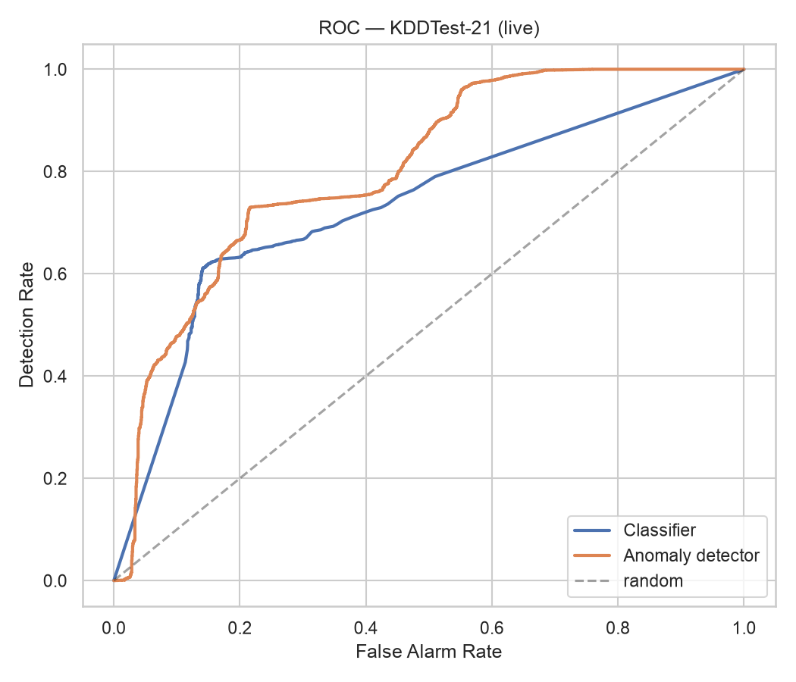
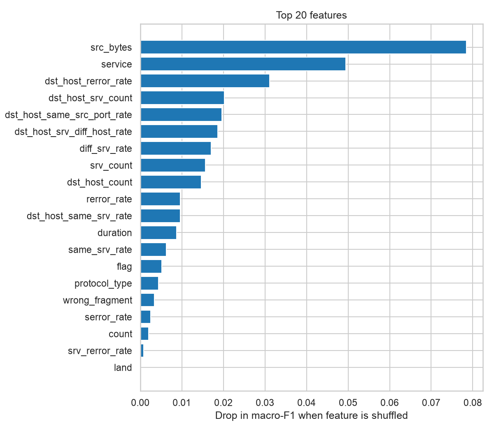

# تقرير نتائج NetSentinel — NSL-KDD

> هذا الملف مولَّد تلقائياً بواسطة `netsentinel train` — لا تعدّله يدوياً.

## NSL-KDD — ملف الميزات الكامل (40 ميزة)

- المصنِّف المختار: **random_forest**
- كاشف الشذوذ المختار: **autoencoder** (عتبة عند النسبة المئوية 99.0)
- سجلات التدريب: 100,778 — سجلات التحقق: 25,195 — أبعاد بعد الترميز: 121
- الفئات التي رآها المصنِّف في التدريب: DoS, Probe, R2L, U2R, normal

### مقارنة المصنِّفات (مجموعة التحقق)

|                        |   f1_macro |   accuracy |   detection_rate |   false_alarm_rate |   train_seconds |
|:-----------------------|-----------:|-----------:|-----------------:|-------------------:|----------------:|
| random_forest          |     0.9743 |     0.999  |           0.9985 |             0.0006 |            13.1 |
| hist_gradient_boosting |     0.9017 |     0.9982 |           0.9991 |             0.0024 |            13.1 |
| logistic_regression    |     0.7095 |     0.9709 |           0.9978 |             0.0518 |            25.9 |
| mlp                    |     0.9586 |     0.9979 |           0.9974 |             0.0015 |             6   |

### مقارنة كواشف الشذوذ (مجموعة التحقق)

|                  |   roc_auc |   detection_rate |   false_alarm_rate |   threshold |   train_seconds |
|:-----------------|----------:|-----------------:|-------------------:|------------:|----------------:|
| isolation_forest |    0.9823 |           0.8023 |               0.01 |    0.552037 |             0.8 |
| autoencoder      |    0.991  |           0.887  |               0.01 |    0.142797 |            13.8 |

### النتائج على KDDTest+ (22,544 سجل — لم يرها النظام أثناء التدريب)

|                 | Detection Rate   | False Alarm Rate   | Precision   |     F1 | Accuracy   |
|:----------------|:-----------------|:-------------------|:------------|-------:|:-----------|
| classifier_only | 57.58%           | 2.61%              | 96.69%      | 0.7218 | 74.73%     |
| anomaly_only    | 68.10%           | 1.62%              | 98.24%      | 0.8044 | 81.14%     |
| hybrid          | 77.10%           | 3.12%              | 97.03%      | 0.8592 | 85.62%     |

- Macro-F1 للتصنيف متعدّد الفئات: **0.4777**

نسبة الكشف لكل فئة (المصنِّف وحده ← الهجين):

- DoS: 77.32% ← **87.13%**
- Probe: 65.96% ← **88.89%**
- R2L: 0.73% ← **41.56%**
- U2R: 4.48% ← **64.18%**

**الهجمات الجديدة (غير موجودة في التدريب) — 3,750 سجل:**

| الوضع | نسبة الكشف |
|---|---|
| المصنِّف وحده | 14.51% |
| كاشف الشذوذ وحده | 48.85% |
| **الهجين** | **49.60%** |

أنواعها: apache2, httptunnel, mailbomb, mscan, named, processtable, ps, saint, sendmail, snmpgetattack, snmpguess, sqlattack, udpstorm, worm, xlock, xsnoop, xterm

**حساسية العتبة (النظام الهجين) — العتبات من طبيعي التحقق:**

|   percentile |   detection_rate |   false_alarm_rate |   precision |     f1 |   novel_dr |
|-------------:|-----------------:|-------------------:|------------:|-------:|-----------:|
|        95    |           0.8565 |             0.0583 |      0.951  | 0.9013 |     0.7699 |
|        99    |           0.771  |             0.0312 |      0.9703 | 0.8592 |     0.496  |
|        99.5  |           0.7065 |             0.029  |      0.9698 | 0.8175 |     0.4251 |
|        99.9  |           0.5947 |             0.0269 |      0.9669 | 0.7365 |     0.1779 |
|        99.99 |           0.5777 |             0.0261 |      0.967  | 0.7233 |     0.1491 |

### النتائج على KDDTest-21 (11,850 سجل — لم يرها النظام أثناء التدريب)

|                 | Detection Rate   | False Alarm Rate   | Precision   |     F1 | Accuracy   |
|:----------------|:-----------------|:-------------------|:------------|-------:|:-----------|
| classifier_only | 43.86%           | 11.76%             | 94.39%      | 0.5989 | 51.92%     |
| anomaly_only    | 58.26%           | 7.16%              | 97.35%      | 0.7289 | 64.54%     |
| hybrid          | 69.69%           | 13.94%             | 95.75%      | 0.8067 | 72.67%     |

- Macro-F1 للتصنيف متعدّد الفئات: **0.3791**

نسبة الكشف لكل فئة (المصنِّف وحده ← الهجين):

- DoS: 61.05% ← **77.90%**
- Probe: 65.70% ← **88.80%**
- R2L: 0.73% ← **41.56%**
- U2R: 4.48% ← **64.18%**

**الهجمات الجديدة (غير موجودة في التدريب) — 3,740 سجل:**

| الوضع | نسبة الكشف |
|---|---|
| المصنِّف وحده | 14.28% |
| كاشف الشذوذ وحده | 48.80% |
| **الهجين** | **49.47%** |

أنواعها: apache2, httptunnel, mailbomb, mscan, named, processtable, ps, saint, sendmail, snmpgetattack, snmpguess, sqlattack, udpstorm, worm, xlock, xsnoop, xterm

**حساسية العتبة (النظام الهجين) — العتبات من طبيعي التحقق:**

|   percentile |   detection_rate |   false_alarm_rate |   precision |     f1 |   novel_dr |
|-------------:|-----------------:|-------------------:|------------:|-------:|-----------:|
|        95    |           0.8102 |             0.2388 |      0.9386 | 0.8697 |     0.7693 |
|        99    |           0.6969 |             0.1394 |      0.9575 | 0.8067 |     0.4947 |
|        99.5  |           0.6117 |             0.1296 |      0.9551 | 0.7457 |     0.4235 |
|        99.9  |           0.4637 |             0.1213 |      0.9451 | 0.6222 |     0.1757 |
|        99.99 |           0.4412 |             0.1176 |      0.9442 | 0.6014 |     0.1468 |

### أهم 10 ميزات (Permutation Importance)

1. `src_bytes` — 0.0269
2. `service` — 0.0083
3. `protocol_type` — 0.0075
4. `flag` — 0.0039
5. `dst_host_same_src_port_rate` — 0.0014
6. `dst_host_srv_rerror_rate` — 0.0010
7. `dst_host_srv_diff_host_rate` — 0.0008
8. `rerror_rate` — 0.0007
9. `diff_srv_rate` — 0.0007
10. `dst_host_rerror_rate` — 0.0006

## NSL-KDD — ملف الميزات الحي (28 ميزة من الترويسات فقط)

- المصنِّف المختار: **mlp**
- كاشف الشذوذ المختار: **autoencoder** (عتبة عند النسبة المئوية 99.0)
- سجلات التدريب: 100,778 — سجلات التحقق: 25,195 — أبعاد بعد الترميز: 109
- الفئات التي رآها المصنِّف في التدريب: DoS, Probe, R2L, U2R, normal

### مقارنة المصنِّفات (مجموعة التحقق)

|                        |   f1_macro |   accuracy |   detection_rate |   false_alarm_rate |   train_seconds |
|:-----------------------|-----------:|-----------:|-----------------:|-------------------:|----------------:|
| random_forest          |     0.9108 |     0.9987 |           0.998  |             0.0006 |            11.3 |
| hist_gradient_boosting |     0.9002 |     0.9979 |           0.999  |             0.0029 |            12.2 |
| logistic_regression    |     0.687  |     0.9639 |           0.9969 |             0.0639 |            22.3 |
| mlp                    |     0.9274 |     0.998  |           0.9975 |             0.0015 |             9.4 |

### مقارنة كواشف الشذوذ (مجموعة التحقق)

|                  |   roc_auc |   detection_rate |   false_alarm_rate |   threshold |   train_seconds |
|:-----------------|----------:|-----------------:|-------------------:|------------:|----------------:|
| isolation_forest |    0.9784 |           0.7979 |               0.01 |    0.572487 |             1   |
| autoencoder      |    0.9936 |           0.8736 |               0.01 |    0.052051 |             9.4 |

### النتائج على KDDTest+ (22,544 سجل — لم يرها النظام أثناء التدريب)

|                 | Detection Rate   | False Alarm Rate   | Precision   |     F1 | Accuracy   |
|:----------------|:-----------------|:-------------------|:------------|-------:|:-----------|
| classifier_only | 66.70%           | 2.98%              | 96.73%      | 0.7895 | 79.76%     |
| anomaly_only    | 65.77%           | 3.22%              | 96.42%      | 0.782  | 79.13%     |
| hybrid          | 78.09%           | 3.71%              | 96.53%      | 0.8634 | 85.93%     |

- Macro-F1 للتصنيف متعدّد الفئات: **0.5445**

نسبة الكشف لكل فئة (المصنِّف وحده ← الهجين):

- DoS: 86.41% ← **95.72%**
- Probe: 69.23% ← **96.37%**
- R2L: 14.97% ← **18.44%**
- U2R: 7.46% ← **22.39%**

**الهجمات الجديدة (غير موجودة في التدريب) — 3,750 سجل:**

| الوضع | نسبة الكشف |
|---|---|
| المصنِّف وحده | 34.45% |
| كاشف الشذوذ وحده | 69.31% |
| **الهجين** | **71.60%** |

أنواعها: apache2, httptunnel, mailbomb, mscan, named, processtable, ps, saint, sendmail, snmpgetattack, snmpguess, sqlattack, udpstorm, worm, xlock, xsnoop, xterm

**حساسية العتبة (النظام الهجين) — العتبات من طبيعي التحقق:**

|   percentile |   detection_rate |   false_alarm_rate |   precision |     f1 |   novel_dr |
|-------------:|-----------------:|-------------------:|------------:|-------:|-----------:|
|        95    |           0.8896 |             0.1128 |      0.9125 | 0.9009 |     0.8195 |
|        99    |           0.7809 |             0.0371 |      0.9653 | 0.8634 |     0.716  |
|        99.5  |           0.7578 |             0.0343 |      0.9669 | 0.8497 |     0.6453 |
|        99.9  |           0.709  |             0.0304 |      0.9686 | 0.8187 |     0.4872 |
|        99.99 |           0.6761 |             0.0298 |      0.9678 | 0.796  |     0.3755 |

### النتائج على KDDTest-21 (11,850 سجل — لم يرها النظام أثناء التدريب)

|                 | Detection Rate   | False Alarm Rate   | Precision   |     F1 | Accuracy   |
|:----------------|:-----------------|:-------------------|:------------|-------:|:-----------|
| classifier_only | 55.93%           | 13.34%             | 94.97%      | 0.704  | 61.51%     |
| anomaly_only    | 55.09%           | 14.13%             | 94.62%      | 0.6964 | 60.68%     |
| hybrid          | 71.00%           | 16.22%             | 95.18%      | 0.8133 | 73.32%     |

- Macro-F1 للتصنيف متعدّد الفئات: **0.4585**

نسبة الكشف لكل فئة (المصنِّف وحده ← الهجين):

- DoS: 76.66% ← **92.66%**
- Probe: 68.98% ← **96.34%**
- R2L: 14.97% ← **18.44%**
- U2R: 7.46% ← **22.39%**

**الهجمات الجديدة (غير موجودة في التدريب) — 3,740 سجل:**

| الوضع | نسبة الكشف |
|---|---|
| المصنِّف وحده | 34.28% |
| كاشف الشذوذ وحده | 69.22% |
| **الهجين** | **71.52%** |

أنواعها: apache2, httptunnel, mailbomb, mscan, named, processtable, ps, saint, sendmail, snmpgetattack, snmpguess, sqlattack, udpstorm, worm, xlock, xsnoop, xterm

**حساسية العتبة (النظام الهجين) — العتبات من طبيعي التحقق:**

|   percentile |   detection_rate |   false_alarm_rate |   precision |     f1 |   novel_dr |
|-------------:|-----------------:|-------------------:|------------:|-------:|-----------:|
|        95    |           0.8539 |             0.4568 |      0.8939 | 0.8734 |     0.819  |
|        99    |           0.71   |             0.1622 |      0.9518 | 0.8133 |     0.7152 |
|        99.5  |           0.6795 |             0.1515 |      0.9529 | 0.7933 |     0.6444 |
|        99.9  |           0.615  |             0.1362 |      0.9532 | 0.7476 |     0.4858 |
|        99.99 |           0.5714 |             0.1334 |      0.9508 | 0.7138 |     0.3738 |

### أهم 10 ميزات (Permutation Importance)

1. `src_bytes` — 0.0785
2. `service` — 0.0495
3. `dst_host_rerror_rate` — 0.0311
4. `dst_host_srv_count` — 0.0203
5. `dst_host_same_src_port_rate` — 0.0196
6. `dst_host_srv_diff_host_rate` — 0.0187
7. `diff_srv_rate` — 0.0171
8. `srv_count` — 0.0157
9. `dst_host_count` — 0.0147
10. `rerror_rate` — 0.0097

