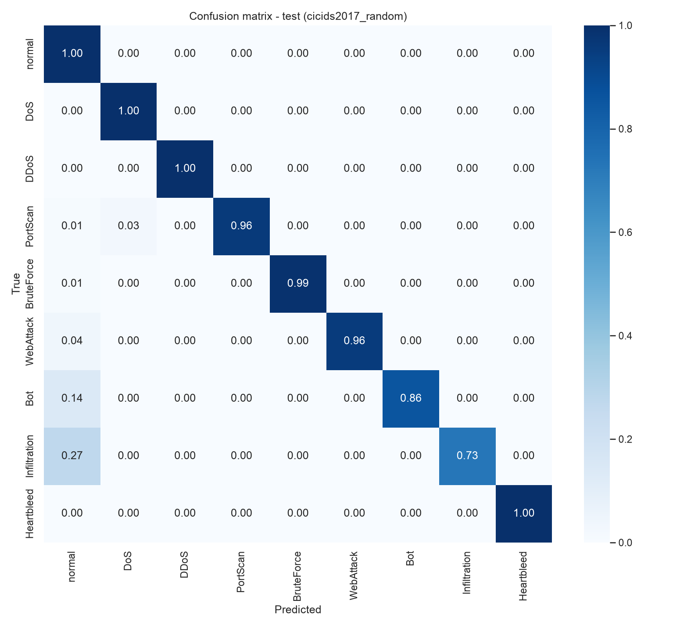
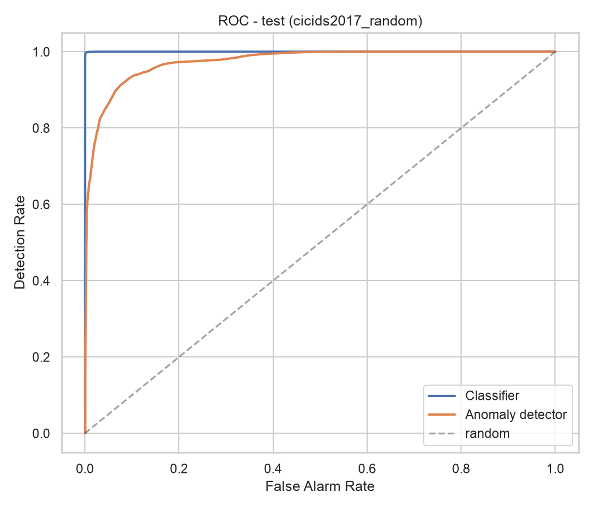
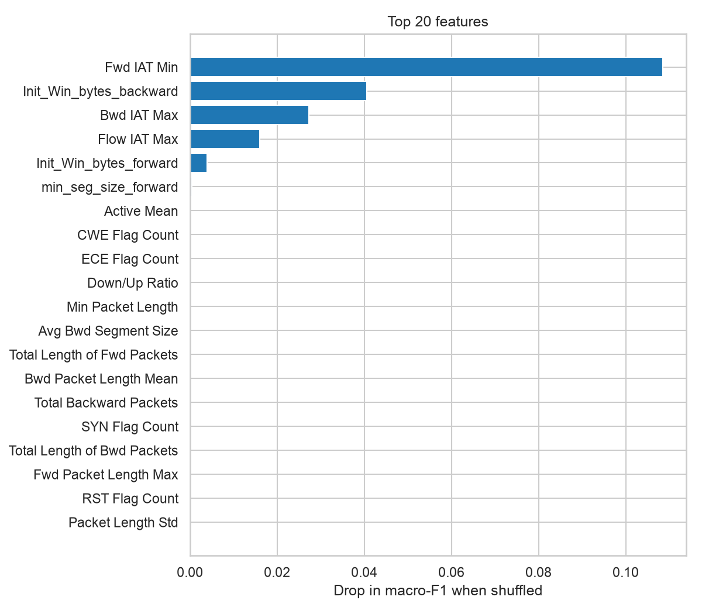
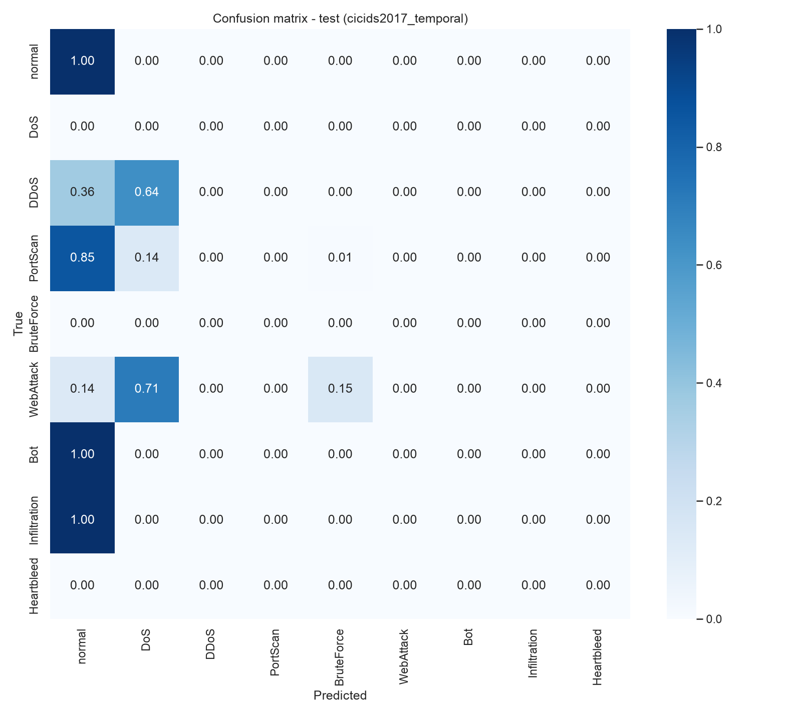
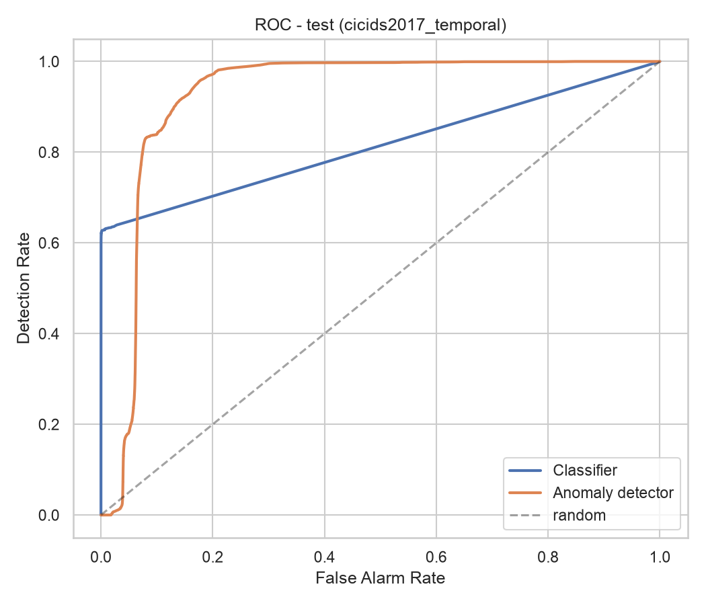
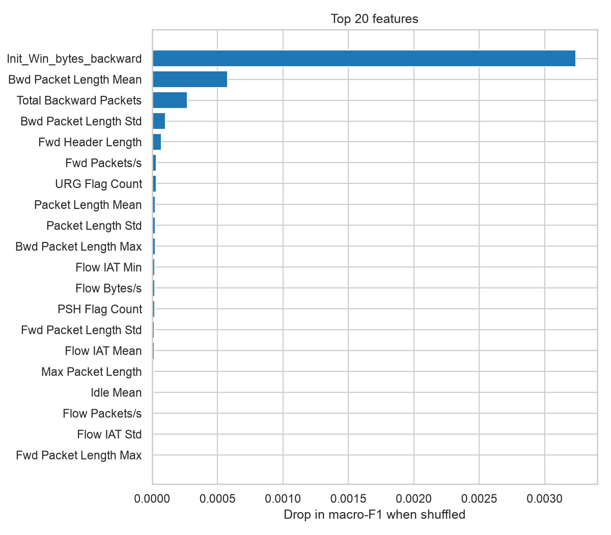

# NetSentinel results - CIC-IDS2017

Generated by `netsentinel train`.

## CIC-IDS2017 - random split

- classifier: **random_forest**
- anomaly detector: **autoencoder** (threshold at percentile 99.0)
- train rows: 299,953, validation rows: 74,989, columns after encoding: 68
- classes seen in training: Bot, BruteForce, DDoS, DoS, Heartbleed, Infiltration, PortScan, WebAttack, normal

### Classifiers (validation set)

|                        |   f1_macro |   accuracy |   detection_rate |   false_alarm_rate |   train_seconds |
|:-----------------------|-----------:|-----------:|-----------------:|-------------------:|----------------:|
| random_forest          |     0.9835 |     0.9977 |           0.9958 |             0.0012 |            58.8 |
| hist_gradient_boosting |     0.9668 |     0.9967 |           0.9991 |             0.0042 |            14.6 |
| logistic_regression    |     0.6446 |     0.9166 |           0.9918 |             0.1171 |            23   |
| mlp                    |     0.9733 |     0.9963 |           0.9929 |             0.0017 |            23.1 |

### Anomaly detectors (validation set)

|                  |   roc_auc |   detection_rate |   false_alarm_rate |   threshold |   train_seconds |
|:-----------------|----------:|-----------------:|-------------------:|------------:|----------------:|
| isolation_forest |    0.9092 |           0.0245 |               0.01 |    0.621556 |             2   |
| autoencoder      |    0.968  |           0.6026 |               0.01 |    0.170207 |            27.4 |

### Test set: test (669,950 rows)

|                 | Detection Rate   | False Alarm Rate   | Precision   |     F1 | Accuracy   |
|:----------------|:-----------------|:-------------------|:------------|-------:|:-----------|
| classifier_only | 99.66%           | 0.12%              | 99.32%      | 0.9949 | 99.85%     |
| anomaly_only    | 65.51%           | 0.93%              | 92.62%      | 0.7674 | 94.02%     |
| hybrid          | 99.68%           | 1.03%              | 94.49%      | 0.9702 | 99.08%     |

- macro-F1 (multi-class): **0.9043**

Detection rate per category (classifier only -> hybrid):

- Bot: 85.61% -> **85.61%**
- BruteForce: 98.98% -> **99.02%**
- DDoS: 99.94% -> **99.95%**
- DoS: 99.67% -> **99.68%**
- Heartbleed: 100.00% -> **100.00%**
- Infiltration: 72.73% -> **90.91%**
- PortScan: 98.98% -> **99.15%**
- WebAttack: 95.96% -> **95.96%**

**Hybrid at other thresholds:**

|   percentile |   detection_rate |   false_alarm_rate |   precision |     f1 | novel_dr   |
|-------------:|-----------------:|-------------------:|------------:|-------:|:-----------|
|        95    |           0.9969 |             0.0503 |      0.7787 | 0.8744 |            |
|        99    |           0.9968 |             0.0103 |      0.9449 | 0.9702 |            |
|        99.5  |           0.9967 |             0.0059 |      0.9678 | 0.982  |            |
|        99.9  |           0.9966 |             0.0021 |      0.9881 | 0.9923 |            |
|        99.99 |           0.9966 |             0.0013 |      0.9925 | 0.9945 |            |

### Top 10 features (permutation importance)

1. `Fwd IAT Min` 0.1085
2. `Init_Win_bytes_backward` 0.0406
3. `Bwd IAT Max` 0.0272
4. `Flow IAT Max` 0.0160
5. `Init_Win_bytes_forward` 0.0040
6. `min_seg_size_forward` 0.0004
7. `Bwd IAT Total` 0.0000
8. `Avg Fwd Segment Size` 0.0000
9. `Bwd IAT Min` 0.0000
10. `Fwd PSH Flags` 0.0000

## CIC-IDS2017 - temporal split (train Mon-Wed, test Thu-Fri)

- classifier: **hist_gradient_boosting**
- anomaly detector: **autoencoder** (threshold at percentile 99.0)
- train rows: 264,048, validation rows: 66,012, columns after encoding: 68
- classes seen in training: BruteForce, DoS, Heartbleed, normal

### Classifiers (validation set)

|                        |   f1_macro |   accuracy |   detection_rate |   false_alarm_rate |   train_seconds |
|:-----------------------|-----------:|-----------:|-----------------:|-------------------:|----------------:|
| random_forest          |     0.9983 |     0.9988 |           0.9969 |             0.0006 |            56.6 |
| hist_gradient_boosting |     0.9987 |     0.9988 |           0.9987 |             0.0012 |            49.2 |
| logistic_regression    |     0.861  |     0.9719 |           0.9865 |             0.032  |            13.3 |
| mlp                    |     0.9114 |     0.9972 |           0.992  |             0.0011 |            16.9 |

### Anomaly detectors (validation set)

|                  |   roc_auc |   detection_rate |   false_alarm_rate |   threshold |   train_seconds |
|:-----------------|----------:|-----------------:|-------------------:|------------:|----------------:|
| isolation_forest |    0.9137 |           0.0551 |               0.01 |    0.614556 |             1.8 |
| autoencoder      |    0.9571 |           0.5316 |               0.01 |    0.13445  |            19.4 |

### Test set: test (811,780 rows)

|                 | Detection Rate   | False Alarm Rate   | Precision   |     F1 | Accuracy   |
|:----------------|:-----------------|:-------------------|:------------|-------:|:-----------|
| classifier_only | 62.50%           | 0.10%              | 99.20%      | 0.7668 | 93.75%     |
| anomaly_only    | 36.83%           | 6.18%              | 53.99%      | 0.4379 | 84.44%     |
| hybrid          | 69.57%           | 6.28%              | 68.57%      | 0.6907 | 89.75%     |

- macro-F1 (multi-class): **0.1071**

Detection rate per category (classifier only -> hybrid):

- Bot: 0.00% -> **0.00%**
- DDoS: 63.55% -> **69.81%**
- Infiltration: 0.00% -> **55.56%**
- PortScan: 14.72% -> **86.96%**
- WebAttack: 86.28% -> **86.28%**

**Attacks not seen in training (133,586 rows):**

| mode | detection rate |
|---|---|
| classifier only | 62.50% |
| anomaly only | 36.83% |
| **hybrid** | **69.57%** |

types: Bot, DDoS, Infiltration, PortScan, Web Attack - Brute Force, Web Attack - Sql Injection, Web Attack - XSS

**Hybrid at other thresholds:**

|   percentile |   detection_rate |   false_alarm_rate |   precision |     f1 |   novel_dr |
|-------------:|-----------------:|-------------------:|------------:|-------:|-----------:|
|        95    |           0.853  |             0.0997 |      0.6275 | 0.7231 |     0.853  |
|        99    |           0.6957 |             0.0628 |      0.6857 | 0.6907 |     0.6957 |
|        99.5  |           0.6293 |             0.0539 |      0.6971 | 0.6615 |     0.6293 |
|        99.9  |           0.6251 |             0.0367 |      0.7704 | 0.6902 |     0.6251 |
|        99.99 |           0.625  |             0.0011 |      0.9915 | 0.7667 |     0.625  |

### Top 10 features (permutation importance)

1. `Init_Win_bytes_backward` 0.0032
2. `Bwd Packet Length Mean` 0.0006
3. `Total Backward Packets` 0.0003
4. `Bwd Packet Length Std` 0.0001
5. `Fwd Header Length` 0.0001
6. `Fwd Packets/s` 0.0000
7. `URG Flag Count` 0.0000
8. `Packet Length Mean` 0.0000
9. `Packet Length Std` 0.0000
10. `Bwd Packet Length Max` 0.0000

