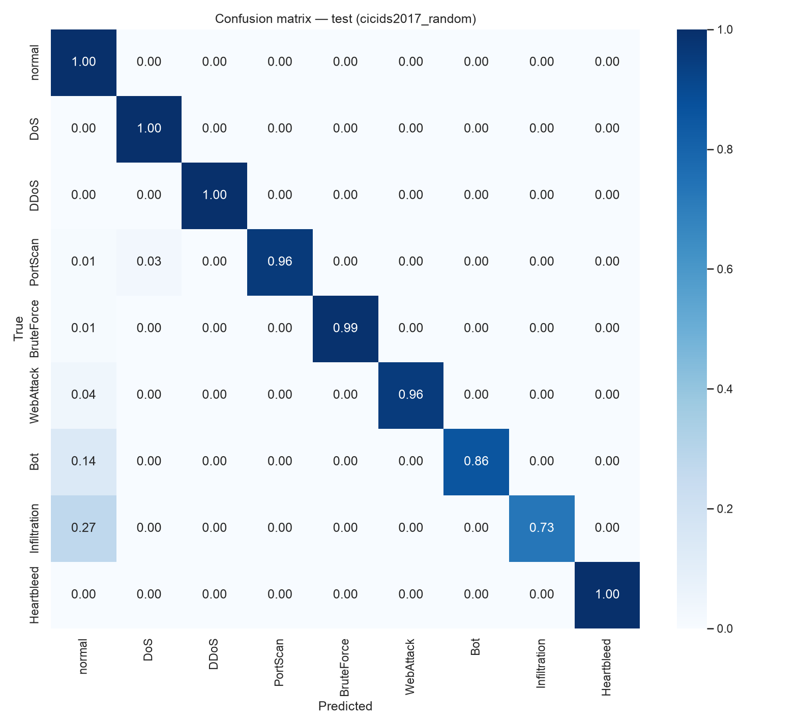
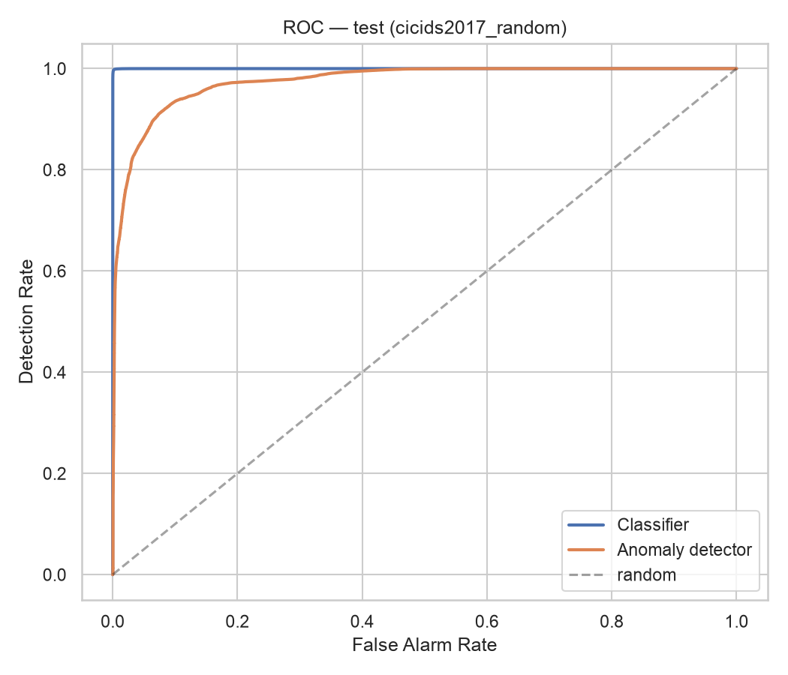
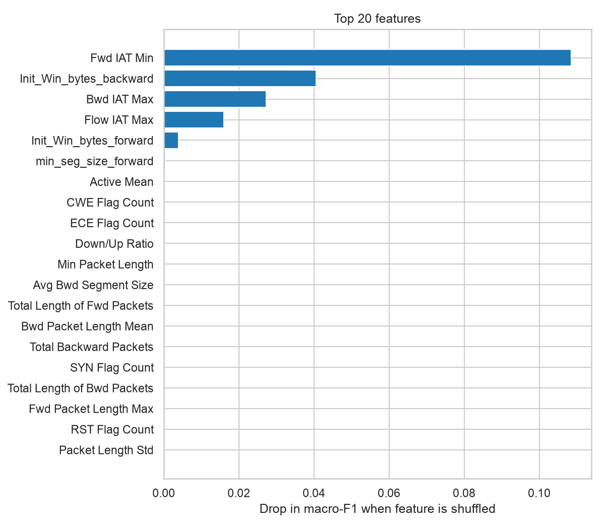
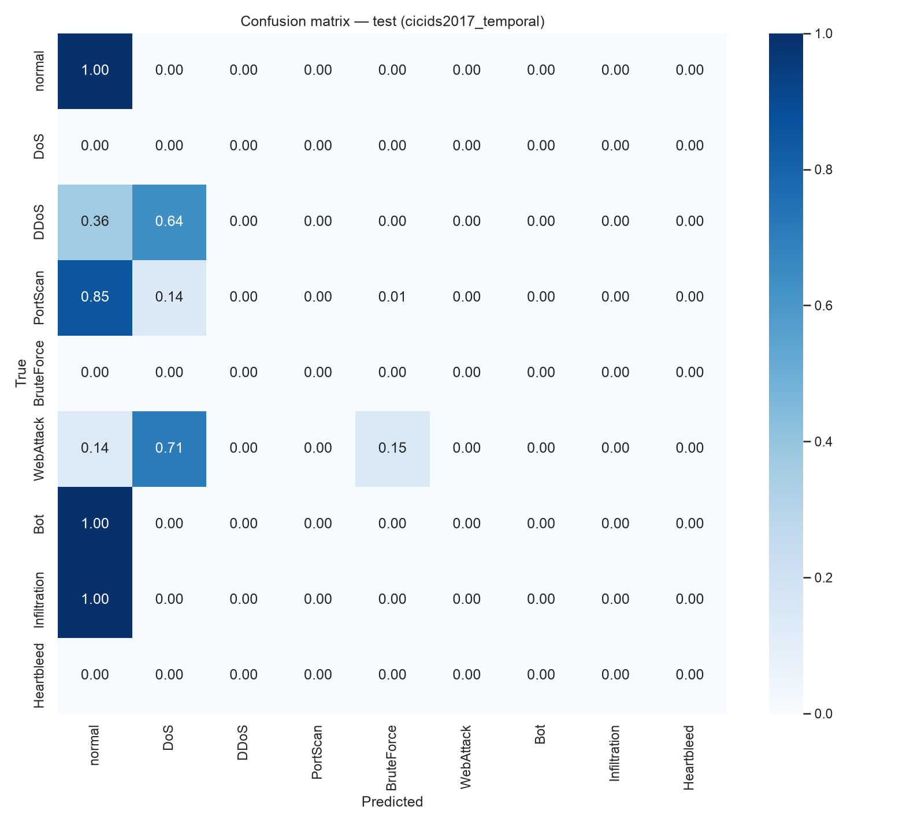
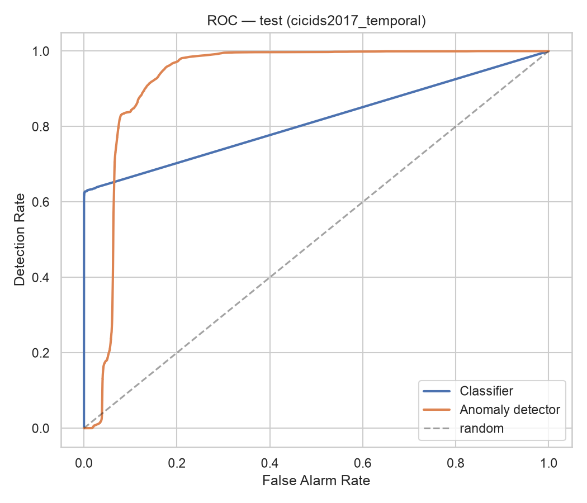
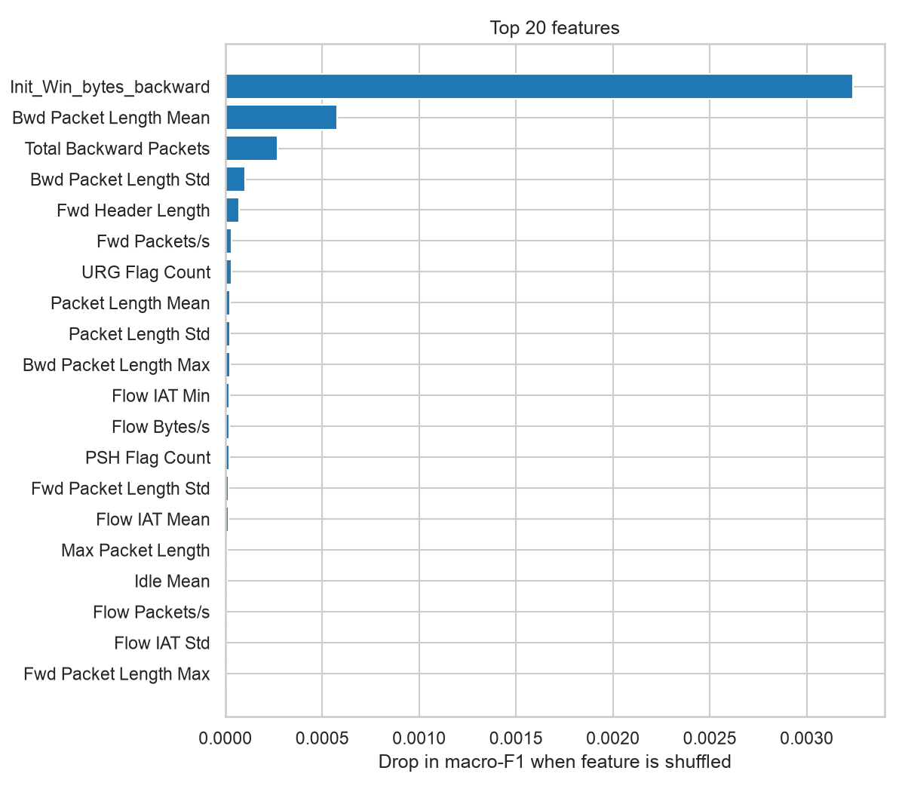

# تقرير نتائج NetSentinel — CIC-IDS2017 (حركة حقيقية)

> هذا الملف مولَّد تلقائياً بواسطة `netsentinel train` — لا تعدّله يدوياً.

## CIC-IDS2017 — تقسيم عشوائي (الطريقة الشائعة في الأبحاث)

- المصنِّف المختار: **random_forest**
- كاشف الشذوذ المختار: **autoencoder** (عتبة عند النسبة المئوية 99.0)
- سجلات التدريب: 299,953 — سجلات التحقق: 74,989 — أبعاد بعد الترميز: 68
- الفئات التي رآها المصنِّف في التدريب: Bot, BruteForce, DDoS, DoS, Heartbleed, Infiltration, PortScan, WebAttack, normal

### مقارنة المصنِّفات (مجموعة التحقق)

|                        |   f1_macro |   accuracy |   detection_rate |   false_alarm_rate |   train_seconds |
|:-----------------------|-----------:|-----------:|-----------------:|-------------------:|----------------:|
| random_forest          |     0.9835 |     0.9977 |           0.9958 |             0.0012 |           233.5 |
| hist_gradient_boosting |     0.9668 |     0.9967 |           0.9991 |             0.0042 |            39   |
| logistic_regression    |     0.6446 |     0.9166 |           0.9918 |             0.1171 |            34.1 |
| mlp                    |     0.9733 |     0.9963 |           0.9929 |             0.0017 |            33.9 |

### مقارنة كواشف الشذوذ (مجموعة التحقق)

|                  |   roc_auc |   detection_rate |   false_alarm_rate |   threshold |   train_seconds |
|:-----------------|----------:|-----------------:|-------------------:|------------:|----------------:|
| isolation_forest |    0.9092 |           0.0245 |               0.01 |    0.621556 |             3.8 |
| autoencoder      |    0.968  |           0.6026 |               0.01 |    0.170207 |            57.8 |

### النتائج على test (669,950 سجل — لم يرها النظام أثناء التدريب)

|                 | Detection Rate   | False Alarm Rate   | Precision   |     F1 | Accuracy   |
|:----------------|:-----------------|:-------------------|:------------|-------:|:-----------|
| classifier_only | 99.66%           | 0.12%              | 99.32%      | 0.9949 | 99.85%     |
| anomaly_only    | 65.51%           | 0.93%              | 92.62%      | 0.7674 | 94.02%     |
| hybrid          | 99.68%           | 1.03%              | 94.49%      | 0.9702 | 99.08%     |

- Macro-F1 للتصنيف متعدّد الفئات: **0.9043**

نسبة الكشف لكل فئة (المصنِّف وحده ← الهجين):

- Bot: 85.61% ← **85.61%**
- BruteForce: 98.98% ← **99.02%**
- DDoS: 99.94% ← **99.95%**
- DoS: 99.67% ← **99.68%**
- Heartbleed: 100.00% ← **100.00%**
- Infiltration: 72.73% ← **90.91%**
- PortScan: 98.98% ← **99.15%**
- WebAttack: 95.96% ← **95.96%**

**حساسية العتبة (النظام الهجين) — العتبات من طبيعي التحقق:**

|   percentile |   detection_rate |   false_alarm_rate |   precision |     f1 | novel_dr   |
|-------------:|-----------------:|-------------------:|------------:|-------:|:-----------|
|        95    |           0.9969 |             0.0503 |      0.7787 | 0.8744 |            |
|        99    |           0.9968 |             0.0103 |      0.9449 | 0.9702 |            |
|        99.5  |           0.9967 |             0.0059 |      0.9678 | 0.982  |            |
|        99.9  |           0.9966 |             0.0021 |      0.9881 | 0.9923 |            |
|        99.99 |           0.9966 |             0.0013 |      0.9925 | 0.9945 |            |

### أهم 10 ميزات (Permutation Importance)

1. `Fwd IAT Min` — 0.1085
2. `Init_Win_bytes_backward` — 0.0406
3. `Bwd IAT Max` — 0.0272
4. `Flow IAT Max` — 0.0160
5. `Init_Win_bytes_forward` — 0.0040
6. `min_seg_size_forward` — 0.0004
7. `Bwd IAT Total` — 0.0000
8. `Avg Fwd Segment Size` — 0.0000
9. `Bwd IAT Min` — 0.0000
10. `Fwd PSH Flags` — 0.0000

## CIC-IDS2017 — تقسيم زمني: تدريب الاثنين–الأربعاء، اختبار الخميس–الجمعة (Zero-day حقيقي)

- المصنِّف المختار: **hist_gradient_boosting**
- كاشف الشذوذ المختار: **autoencoder** (عتبة عند النسبة المئوية 99.0)
- سجلات التدريب: 264,048 — سجلات التحقق: 66,012 — أبعاد بعد الترميز: 68
- الفئات التي رآها المصنِّف في التدريب: BruteForce, DoS, Heartbleed, normal

### مقارنة المصنِّفات (مجموعة التحقق)

|                        |   f1_macro |   accuracy |   detection_rate |   false_alarm_rate |   train_seconds |
|:-----------------------|-----------:|-----------:|-----------------:|-------------------:|----------------:|
| random_forest          |     0.9983 |     0.9988 |           0.9969 |             0.0006 |           141.8 |
| hist_gradient_boosting |     0.9987 |     0.9988 |           0.9987 |             0.0012 |            45.7 |
| logistic_regression    |     0.861  |     0.9719 |           0.9865 |             0.032  |            16.2 |
| mlp                    |     0.9114 |     0.9972 |           0.992  |             0.0011 |            22.7 |

### مقارنة كواشف الشذوذ (مجموعة التحقق)

|                  |   roc_auc |   detection_rate |   false_alarm_rate |   threshold |   train_seconds |
|:-----------------|----------:|-----------------:|-------------------:|------------:|----------------:|
| isolation_forest |    0.9137 |           0.0551 |               0.01 |    0.614556 |             2.4 |
| autoencoder      |    0.9571 |           0.5316 |               0.01 |    0.13445  |            22.5 |

### النتائج على test (811,780 سجل — لم يرها النظام أثناء التدريب)

|                 | Detection Rate   | False Alarm Rate   | Precision   |     F1 | Accuracy   |
|:----------------|:-----------------|:-------------------|:------------|-------:|:-----------|
| classifier_only | 62.50%           | 0.10%              | 99.20%      | 0.7668 | 93.75%     |
| anomaly_only    | 36.83%           | 6.18%              | 53.99%      | 0.4379 | 84.44%     |
| hybrid          | 69.57%           | 6.28%              | 68.57%      | 0.6907 | 89.75%     |

- Macro-F1 للتصنيف متعدّد الفئات: **0.1071**

نسبة الكشف لكل فئة (المصنِّف وحده ← الهجين):

- Bot: 0.00% ← **0.00%**
- DDoS: 63.55% ← **69.81%**
- Infiltration: 0.00% ← **55.56%**
- PortScan: 14.72% ← **86.96%**
- WebAttack: 86.28% ← **86.28%**

**الهجمات الجديدة (غير موجودة في التدريب) — 133,586 سجل:**

| الوضع | نسبة الكشف |
|---|---|
| المصنِّف وحده | 62.50% |
| كاشف الشذوذ وحده | 36.83% |
| **الهجين** | **69.57%** |

أنواعها: Bot, DDoS, Infiltration, PortScan, Web Attack - Brute Force, Web Attack - Sql Injection, Web Attack - XSS

**حساسية العتبة (النظام الهجين) — العتبات من طبيعي التحقق:**

|   percentile |   detection_rate |   false_alarm_rate |   precision |     f1 |   novel_dr |
|-------------:|-----------------:|-------------------:|------------:|-------:|-----------:|
|        95    |           0.853  |             0.0997 |      0.6275 | 0.7231 |     0.853  |
|        99    |           0.6957 |             0.0628 |      0.6857 | 0.6907 |     0.6957 |
|        99.5  |           0.6293 |             0.0539 |      0.6971 | 0.6615 |     0.6293 |
|        99.9  |           0.6251 |             0.0367 |      0.7704 | 0.6902 |     0.6251 |
|        99.99 |           0.625  |             0.0011 |      0.9915 | 0.7667 |     0.625  |

### أهم 10 ميزات (Permutation Importance)

1. `Init_Win_bytes_backward` — 0.0032
2. `Bwd Packet Length Mean` — 0.0006
3. `Total Backward Packets` — 0.0003
4. `Bwd Packet Length Std` — 0.0001
5. `Fwd Header Length` — 0.0001
6. `Fwd Packets/s` — 0.0000
7. `URG Flag Count` — 0.0000
8. `Packet Length Mean` — 0.0000
9. `Packet Length Std` — 0.0000
10. `Bwd Packet Length Max` — 0.0000

